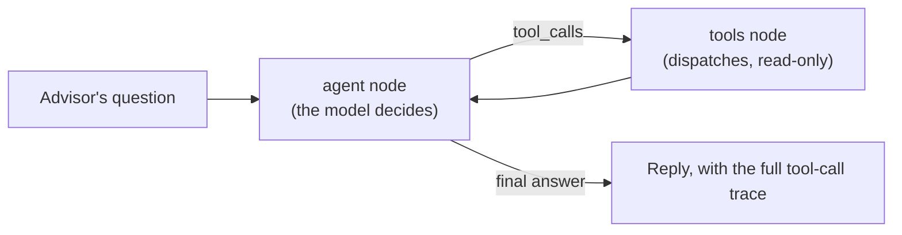

# AdvisorAI

A client management and planning platform for Canadian financial advisors, with an AI assistant that explains a client's situation using numbers it can always trace back to a calculation.

Advisors keep each client's household, finances, insurance, and goals in one place. AdvisorAI turns that data into an insurance needs analysis, registered-account recommendations, a risk profile, and a financial plan. The AI assistant then answers questions about the client in plain language.

<!-- Add a screenshot or short GIF here, for example:

-->

## Features

- **Client and household profiles**: clients, spouse, and dependents, with the planning details an advisor needs for a first meeting.
- **Finances**: accounts (including TFSA, RRSP, FHSA, and RESP), transactions, budgets, goals, income sources, and debts.
- **Insurance**: existing policies alongside a financial needs analysis (FNA) that estimates the coverage gap.
- **Recommendations**: rule-based suggestions for insurance and registered accounts, shown together with the FNA.
- **Risk questionnaire**: the advisor sends the client a public link, the client fills it in without logging in, and the answers are scored into a risk tolerance profile.
- **Financial plan**: a generated plan with action items the advisor can track.
- **Fund comparison**: a catalog of tracked funds with a performance comparison chart based on real daily prices.
- **AI assistant**: a chat tab on each client that answers questions such as "Is this client underinsured?" or "Why are you recommending the FHSA first?", and can search a client's uploaded insurance policy documents for cited passages.

## Architecture

The AI assistant is a [LangGraph](https://langchain-ai.github.io/langgraph/) state machine with two nodes: `agent` (the model decides what to do next) and `tools` (dispatches whichever tools it asked for). The design rule is simple: **the model never calculates a financial number itself.**



Every figure comes from a deterministic Python function. The model's job is to decide which tools to call, read the results, and explain them. A `recursion_limit` on the graph (derived from `AI_AGENT_MAX_TOOL_ITERATIONS`) is the guardrail against a pathological tool-call loop — if it's hit, the assistant says so rather than guessing. It has seven read-only tools:

| Tool | What it returns |
| --- | --- |
| `get_financial_summary` | Income, expenses, net worth, and cash flow |
| `get_insurance_recommendation` | Coverage need and gap from the FNA |
| `get_registered_account_recommendations` | TFSA, RRSP, FHSA, and RESP priorities |
| `get_risk_tolerance` | The scored risk questionnaire result |
| `generate_financial_plan_preview` | A draft plan with action items |
| `compare_funds` | Performance of tracked funds over a period |
| `search_policy_documents` | Cited passages from the client's uploaded insurance policy documents |

The system prompt requires the assistant to call a tool before stating any number, to cite the tool calls behind its answers, and to say so plainly when the tools cannot answer a question. Each conversation is stored with its tool calls, so an advisor can see exactly where an answer came from.

The rule thresholds and Canadian account limits live in their own modules as named constants, so they can be reviewed and updated each tax year without touching the logic.

### Policy document search (RAG)

Advisors can upload a client's insurance policy (`POST /clients/{id}/documents`, category `insurance_policy`). The text is chunked and embedded into Postgres via [pgvector](https://github.com/pgvector/pgvector) and [langchain-postgres](https://github.com/langchain-ai/langchain-postgres), scoped to that client — one client's policy details never surface in another's search results. The `search_policy_documents` tool then lets the assistant answer questions like "What does this policy say about the surrender value?" with a cited passage and source document, never a number it invented.

### Chat model provider

`CHAT_MODEL_PROVIDER` picks which LLM backs the assistant: `anthropic` (default), `openai`, or `ollama` (a local model). Ollama's tool-calling is best-effort only — see [Status and limitations](#status-and-limitations).

### Tracing

Setting `LANGSMITH_TRACING=true` (plus `LANGSMITH_API_KEY`) sends a trace of every agent run to [LangSmith](https://smith.langchain.com/). Off by default, with no behavior change either way.

## Tech stack

| Layer | Tools |
| --- | --- |
| Backend | Python 3.12, FastAPI, SQLAlchemy 2, Alembic, Pydantic |
| Database | PostgreSQL 17 (pgvector) |
| AI orchestration | LangGraph, LangChain (Anthropic Claude by default; OpenAI or Ollama optional) |
| RAG | pgvector via langchain-postgres, OpenAI embeddings |
| Observability | LangSmith (optional, off by default) |
| Market data | Twelve Data |
| Frontend | React 19, TypeScript, Vite, Tailwind CSS, shadcn/ui, TanStack Query and Table, Recharts |
| Testing | pytest (325+ tests), Ruff |

## Project structure

```
advisor-ai/
├── apps/
│   ├── api/                 FastAPI backend
│   │   ├── app/
│   │   │   ├── api/routes/  REST endpoints
│   │   │   ├── models/      SQLAlchemy models
│   │   │   ├── schemas/     Pydantic schemas
│   │   │   └── services/    Calculations, recommendations, AI agent and tools
│   │   ├── migrations/      Alembic migrations
│   │   └── tests/
│   └── web/                 React frontend
│       └── src/
│           ├── api/         Typed API client (generated from OpenAPI)
│           └── features/    One folder per tab or page
├── docker-compose.yml       PostgreSQL
└── .env.example
```

## Getting started

### Prerequisites

- Docker
- Python 3.12 or newer, and [uv](https://docs.astral.sh/uv/)
- Node.js 20 or newer

### 1. Start the database

```bash
docker compose up -d
```

### 2. Configure the environment

```bash
cp .env.example apps/api/.env
```

Then open `apps/api/.env` and add the optional keys if you want those features (all of them, grouped and commented, are already listed in `.env.example`):

| Variable | Required | Purpose |
| --- | --- | --- |
| `DATABASE_URL` | Yes | PostgreSQL connection string (already set in the example) |
| `PUBLIC_BASE_URL` | No | Frontend origin used to build the risk-questionnaire shareable link |
| `CORS_ALLOWED_ORIGINS` | No | Allowed frontend origins |
| `MARKET_DATA_API_KEY` | No | Twelve Data key, enables fund performance comparison |
| `MARKET_DATA_BASE_URL` | No | Overrides the market-data provider's base URL |
| `ANTHROPIC_API_KEY` | No | Enables the AI assistant (default provider). Without it, the assistant endpoint returns 503 and the rest of the app works normally. |
| `AI_AGENT_MODEL` | No | Overrides the default chat model |
| `AI_AGENT_MAX_TOOL_ITERATIONS` | No | Caps how many tool calls one turn can make before the assistant gives up |
| `CHAT_MODEL_PROVIDER` | No | `anthropic` (default), `openai`, or `ollama` |
| `OPENAI_API_KEY` | No | Required if `CHAT_MODEL_PROVIDER=openai`; always used for policy-document embeddings (RAG) regardless of chat provider |
| `OLLAMA_BASE_URL` | No | Where to reach a local Ollama server if `CHAT_MODEL_PROVIDER=ollama` |
| `EMBEDDING_MODEL_NAME` | No | Overrides the default OpenAI embedding model |
| `PGVECTOR_COLLECTION_NAME` | No | pgvector collection name for policy-document chunks |
| `DOCUMENT_STORAGE_DIR` | No | Where uploaded client documents are saved on disk |
| `LANGSMITH_TRACING` | No | Set to `true` to trace agent runs in LangSmith |
| `LANGSMITH_API_KEY` | No | Required if `LANGSMITH_TRACING=true` |
| `LANGSMITH_PROJECT` | No | LangSmith project name |

### 3. Run the API

```bash
cd apps/api
uv sync
uv run alembic upgrade head
uv run fastapi dev app/main.py
```

The API runs at http://localhost:8000, with interactive docs at http://localhost:8000/docs.

### 4. Run the web app

```bash
cd apps/web
npm install
npm run dev
```

Open http://localhost:5173, create an advisor, and add your first client.

## Running the tests

The tests run against the local database, so make sure PostgreSQL is up and migrations are applied.

```bash
cd apps/api
uv run pytest
```

The suite includes an eval set for the agent loop and for RAG retrieval. Both use a scripted model / fake embeddings, so they run without any API key, and check that tool calls are dispatched correctly, the loop stops when it should, and policy-document search returns the right document for an obviously relevant question.

## Status and limitations

AdvisorAI is a personal project under active development.

- **Authentication is not built yet.** The API currently identifies the advisor from an `X-Advisor-Id` header. Do not deploy it with real client data.
- **Registered-account figures are simplified.** They are rule-of-thumb annual limits, not a per-person CRA contribution room calculation.
- **Ollama tool-calling is best-effort only.** Local models can emit malformed tool calls or skip one they should have made. The assistant falls back to saying it can't answer rather than guessing, same as any provider, but there's no extra validation specific to this case.
- **Uploaded documents are stored on local disk**, not a production-grade object store — fine for development, not for deployment.
- **This is not financial advice.** The recommendations are a starting point for a licensed advisor's own judgment.

## Author

Built by Maryam ([@maryamfad](https://github.com/maryamfad)).
